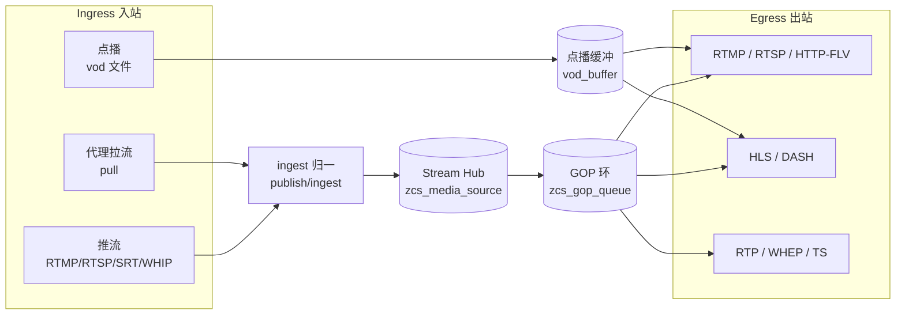
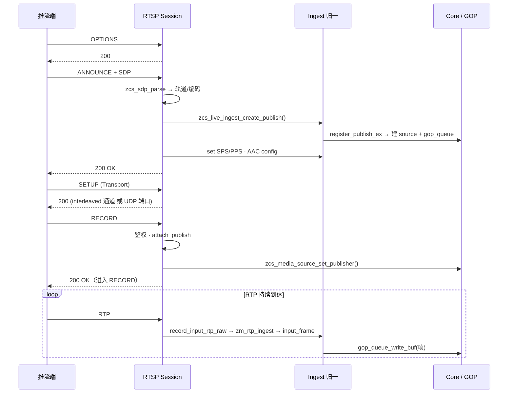
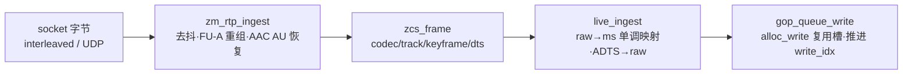
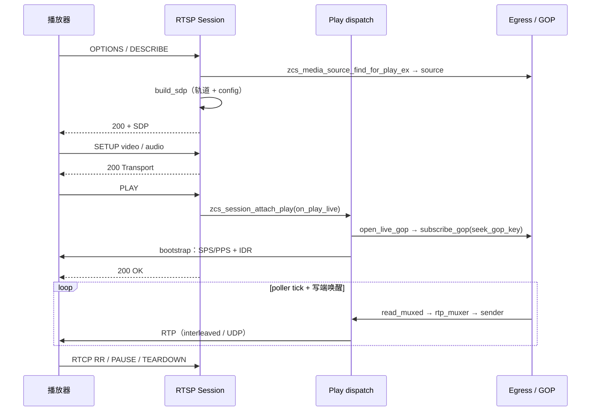
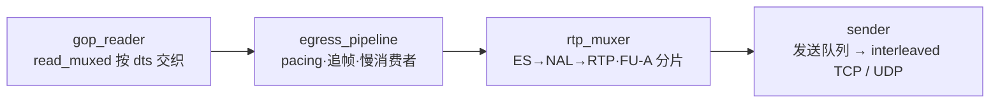

# ZCS 数据通路与运行约定

> 这是 **ZCS 唯一的一份总文档**：能力边界（能做什么/不能做什么）、URL 规则（怎么用）、
> 运行模型约定（改代码要守的规矩）、数据通路（代码怎么布局和衔接）、安全传输。
>
> 读法：只想用 → 看 1、2；要改代码 → 先看 3，再看 4、6；审安全 → 看 5。
> 目录级重构仍有两处未落地（SRT 业务在 `protocol/srt/`、`play/` 尚未并入 `egress/`），文中已标注。

---

## 1. 能力矩阵：能干什么，不能干什么

### 1.1 协议

| 方向 | 协议 | 入口 | 默认 |
|---|---|---|---|
| **推流** | RTMP | `session/rtmp/session_publish.c` | ✅ 编译 |
| | RTSP RECORD | `session/rtsp/{announce,record}.c` | ✅ 编译 |
| | SRT（MPEG-TS） | `protocol/srt/session_publish.c` | 关（需 libsrt） |
| | WHIP（WebRTC 推） | `session/webrtc/whip_ingress.c` | 关（需 OpenSSL） |
| | RTP-PS 直推（外部/GB28181） | `publish/rtp/ps_dispatch.c` | ✅ |
| **播放** | RTMP / RTSP | `session/<proto>/session_play.c` | ✅ |
| | HTTP-FLV / WS-FLV | `session/http/flv_handler.c` | ✅ |
| | HTTP-TS | `session/http/ts_dispatch.c` | ✅ |
| | HLS / DASH | `play/hls/` · `play/dash/` | ✅ |
| | SRT | `protocol/srt/session_play.c` | 关 |
| | WHEP（WebRTC 播） | `session/webrtc/{play_session,whep_route}.c` | 关 |
| **点播** | 本地文件 | `vod/io/` · `vod/play/play_lane.c` | ✅ |
| **代理** | 拉流转发 | `pull/proxy.c` + `protocol/*/client.c` | ✅ |
| **运维** | HTTP API / webhook / 健康检查 | `ops/api/` | ✅ |
| **嵌入** | 链 `zcs` 当库 | `zcs/sdk.h`（create→start→run→stop→destroy） | ✅ |

### 1.2 音视频格式（每个出口允许的 codec 组合）

编解码白名单在 [core/codec_filter.c](../src/core/codec_filter.c) 里**卡死**：入口不支持的组合直接拒掉，不做"半通不通"的播放。

| 出口角色 | 视频 | 音频 |
|---|---|---|
| RTSP（推/播） | H264 · H265 · H266 · AV1 · VP8 · VP9 | AAC · G711A · G711U · Opus |
| RTMP · HTTP-FLV · WS-FLV | H264 · H265 · AV1 | AAC · G711A · G711U |
| HTTP-TS · SRT · RTP-PS | H264 · H265 | AAC · G711A · G711U |
| HLS · DASH | H264 · H265 · H266 · AV1 · VP8 · VP9 | AAC · Opus |
| WebRTC（WHEP/WHIP） | H264 · H265 · AV1 · VP8 · VP9 | Opus · G711A · G711U（浏览器不支持的音轨自动降级为**纯视频**） |

### 1.3 编译 / 配置开关

| 能力 | 编译 | 配置 |
|---|---|---|
| SRT | `-DZCS_ENABLE_SRT=ON`（需 libsrt） | `[protocol] enable_srt=1`、`[srt] port=` |
| WebRTC | `-DZCS_ENABLE_WEBRTC=ON` + OpenSSL | `[webrtc] enable=1`、`[general] externIP=` 填外网可达 IP |
| TLS | `-DZN_ENABLE_OPENSSL=ON`（默认 ON） | `[ssl] cert_file/key_file` + 各协议 `sslport`（见第 5 节） |

默认只编 RTMP / RTSP / HTTP。缺库只 WARNING，对应功能不编进去。

---

## 2. URL 规则

媒体源的唯一标识是 **schema × vhost × app × stream**（见 `core/stream/hub.c`）。
`app` 默认 `live`；`vhost` 默认 `__defaultVhost__`，`[general] enableVhost=1` 时才按
Host/`?vhost=` 区分。所有协议共用同一张流表，不允许各协议自己维护。

### 2.1 直播（app 默认 `live`）

| 用途 | 地址 |
|---|---|
| 推 RTMP | `rtmp://host:1935/{app}/{stream}` |
| 推 RTSP RECORD | `rtsp://host:8554/{app}/{stream}` |
| 推 SRT | `srt://host:9000?streamid=#!::r={app}/{stream},m=publish` |
| 推 WHIP | `POST http://host:8080/index/api/whip?app={app}&stream={stream}` |
| 播 RTMP / RTSP | `rtmp://host:1935/{app}/{stream}` · `rtsp://host:8554/{app}/{stream}` |
| 播 HTTP-FLV | `http://host:8080/{app}/{stream}.flv`（也兼容 `{stream}.live.flv`） |
| 播 WS-FLV | 同上路径，`ws://` 升级 |
| 播 HTTP-TS | `http://host:8080/{app}/{stream}.ts` |
| 播 HLS | `http://host:8080/{app}/{stream}.m3u8` 或 ZLM 兼容 `/{app}/{stream}/hls.m3u8`；分片 `{stream}.{N}.ts` / `{stream}.{N}.m4s` / `{stream}.init.mp4` |
| 播 DASH | `http://host:8080/{app}/{stream}.mpd`；分片 `{stream}-init.mp4`、`{stream}-{N}.m4s` |
| 播 SRT | `srt://host:9000?streamid=#!::r={app}/{stream},m=request` |
| 播 WHEP | `POST http://host:8080/index/api/whep?app={app}&stream={stream}`（ZLM 别名 `/index/api/webrtc?app=&stream=&type=play`） |

> 同名 live 流被再推一次会**踢掉旧推流端并清空该源 GOP**，由新推流接上（不会两路同时写）。

### 2.2 点播（app = `[record] app`，默认 `vod`）

文件放在 `[record] root` 指向的目录（默认 `./www/record`）。路径相对该根目录，且做穿越防护（拒绝 `..`／绝对路径）。

| 用途 | 地址 |
|---|---|
| HTTP-FLV 封装播放 | `http://host:8080/{vod}/path/to/{file}.{mp4\|mkv\|mov\|m4v}.flv` |
| HTTP 原生 FLV 文件 | `http://host:8080/{vod}/path/to/{file}.flv` |
| MP4 直连 | `http://host:8080/{vod}/{file}.mp4` |
| HLS | `http://host:8080/{vod}/path/to/{file}.m3u8`（+ `.ts` 分片） |
| 录像回放 | `/index/api/record/download`、录像 MP4 路由（`session/http/vod_http_handler.c`） |
| RTSP / RTMP 点播 | `rtsp://host:8554/{vod}/{file}.mp4` · `rtmp://host:1935/{vod}/{file}.mp4` |

### 2.3 拉流代理

- 配置：`[proxy] proxy_pull=<远端URL>`、`proxy_app`、`proxy_stream`（留空=沿用远端）。
- API：`/index/api/proxy/add`、`proxy/del`、`proxy/list`。
- 支持拉 `rtsp` / `rtmp` / `srt` / `http-flv`；拉回后与本地推流一样进 GOP 环，可被任意协议播放。

### 2.4 通用参数

| 参数 | 作用 | 示例 |
|---|---|---|
| `vhost` | 多租户维度（`enableVhost=1` 时） | `?vhost=example.com` |
| 鉴权 token | 推/播都验签，参数随协议放在 query / streamid | 见第 3.2 节 |
| FLV seek | 点播/录像拖动起点（秒，兼容多别名） | `?start=12` / `?t=12.34` |

---

## 3. 运行模型约定（改代码前必读）

> 这是**强制约定**，不是建议。底层通信只有「poller 可读 / 可写」两种事件，鉴权与录制都不许另起线程漂移。

### 3.1 线程模型

**poller 线程只做非阻塞的事；线程种类越少越好。**

| 线程 | 数量 | 职责 | 禁止 |
|---|---|---|---|
| poller 线程 | `poller_threads`（默认 2） | 所有 socket 事件、定时器、协议状态机、鉴权验签、webhook 通知、录制同步写 | 阻塞调用、DNS、sleep、跨线程等锁 |
| 后台 IO 线程池 | 固定少量 | VOD 文件、录制「关文件」等慢磁盘 | 访问会话状态/poller 独占数据 |
| 专用协议线程 | 仅协议库强制时（如 SRT） | 该协议收发 | 回调里直接改 zcs 会话状态；须投递回 poller |

- 延时用 `zn_poller_do_delay` / `zn_timer_*`，禁止 `zb_sleep_ms`。
- poller 线程内访问会话数据是**独占**的，不加锁；跨线程访问必须 `zn_poller_async(io, fn, ctx, 0)` 回投到属主 poller。
- 单次回调处理条数必须设上限（避免单会话饿死其他会话）。

### 3.2 鉴权模型（本地 token 验签，不回调 hook）

| 来源 | 是否鉴权 |
|---|---|
| 外部主动推流：RTMP publish、RTSP RECORD、WHIP、SRT、外部 RTP-PS | **是** |
| 信令协商推流：GB28181、ONVIF | 否（上级平台保证） |
| 播放：HTTP-FLV/TS/MP4、HLS、RTSP/RTMP/SRT play、WHEP | **是** |

- 业务鉴权在 web 后台做完，签发带时效 token；流媒体**只做本地验签**（解参、验签、验时效→允许/拒绝+是否录制），**不查库、不回调、不发网络请求**。
- 入口唯一：`zcs_auth_check()`；实现通过 `zcs_auth_set_verifier()` 注册。`[auth] enable=0`（默认）全放行；`=1` 未注册实现时 **fail-closed**。
- 必须在调用方线程同步返回、纯本地计算；**禁止**网络/DNS/磁盘/sleep/等锁。
- 拒绝按协议回码：RTMP `BadAuth`、RTSP/HTTP `403`、SRT 关闭、RTP-PS `ZN_ERR_DENIED`。
- 各协议只把原始 query 放进 `zcs_auth_request.params`，不解析业务字段。

### 3.3 录制模型（对齐 ZLMediaKit）

- 写盘在 **poller 上同步**：帧直接交封装器写 `mp4_writer_write`，靠 `FILE*` 缓冲吸收；不加队列、不加 worker。
- 只有「关文件」异步：切片/停推时**同步摘下**旧 `mov`/`fp`、立刻开新文件，把关闭 + `fflush`/`fclose`/`rename` 投递到后台 IO 池。
- 切片规则：视频按「超 `mp4_max_second` 且当前是关键帧」切；纯音频按超时切；先写 `.<name>.mp4` 临时名，关闭后 `rename`。
- **poller 上禁止**：`fflush`/`fclose`/`rename`/算文件大小。

### 3.4 内存模型

- 入站帧进 `zcs_gop_queue` 后由队列持有引用；`read*` 返回的 `slot.data` 只保证到该 reader **下一次读取之前**有效（`held_ref`）。
- 因此：同线程「读一帧→立即消费/写盘」安全；**交给别的线程或长期保存必须先拷贝或增引用**。
- 会话对象只能在其 poller 线程释放；有未完成异步回调时不得释放（`destroy_token`/引用计数）；延迟销毁只有一个归属者。
- 缓冲池分配的缓冲区归分配线程所有，跨线程释放必须回投。

---

## 4. 数据通路（代码怎么布局和衔接）

### 4.1 总览：三进一出，中枢是 Stream Hub

> 一句话：**推流 = 把各协议裸流拍平成同一种 ES 帧，写进 GOP 环；播放 = 从 GOP 环挂一个独立读游标，按目标协议重新打包。** 协议层很薄，重活都在「入站归一」和「出站重封」两端。

### 4.2 目录 ↔ 数据流映射

| 目录 | 在数据流里的位置 | 负责 |
|---|---|---|
| `protocol/` | 最外层 | 纯线协议编解码：握手、分帧、解析、SDP/STUN/DTLS。**不认识会话、不碰业务** |
| `session/<proto>/` | 连接生命周期 | 每协议 server + 会话状态机：把报文变成「推 or 播」，驱动出站节拍 |
| `publish/ingest/` | 入站归一 | 协议裸流→统一 `zcs_frame`，时间戳映射、AAC ADTS→raw，再写 GOP 环（协议无关） |
| `core/stream/hub.c` | 中枢注册表 | `zcs_media_source` 增删查、推流注册、播放查找、停推关闭 |
| `core/gop/queue.c` | 中枢缓存 | GOP 环形队列：单写多读、GOP 索引、循环裁剪、延迟释放 |
| `play/` | 出站分发 | 播放 dispatch + HTTP 家族输出（HLS/DASH/HTTP-FLV 切片） |
| `egress/` | 出站泵 | `source/`(挂读者) · `pipeline/`(泵) · `rtp/`(打包) · `recorder/`(录制) · `pacing/`(平滑) |
| `vod/` | 点播域 | `io/` 文件读+seek，`play/play_lane` 播放垫片（自带通道，与直播互斥） |
| `pull/` | 入站（客户端侧） | 代理拉流：连别人取回，走 ingest 入环 |
| `bridge/` | 依赖适配 | ZCS ↔ zmedia（`zm_*`）边界；裸 zm C 头只应出现在这里 |
| `media/` | 编解码适配 | codec ES 位流、容器读写、wire 编解码（薄封装 3rdpart/zmedia） |
| `message/` | 跨协议外壳 | `zcs_msg` 键值报文 + XML 助手（原 `proto/`） |
| `ops/` | 组合根 | 进程启动、配置(`ops/config/`)、HTTP API、webhook、模块注册 |
| `device/` | 设备域 | GB28181 / ONVIF 控制面（独立域，不进 ingress/egress） |

### 4.3 RTSP 推流时序

关键调用链：`announce.c:handle_announce` → `create_publish`；`session_setup.c:handle_setup`；
`record.c:handle_record` → `attach_publish` → `set_publisher`；RTP：`record_input_rtp_raw`（record.c）
→ `bridge/zm_rtp_ingest.c` 解包 → `rtsp_zm_on_packet` → `zcs_live_ingest_input_frame`。

### 4.4 入站归一：一块 RTP 怎么变成环里的一帧

| `zcs_frame` 字段 | 含义 |
|---|---|
| `codec / track` | H264/H265/AAC…；视频/音频 |
| `dts_ms / pts_ms` | 驱动 A/V 交织与 pacing |
| `keyframe / config_frame` | GOP 边界、SPS/PPS |
| `data / size` | Annex-B / raw AAC |

归一要点：SPS/PPS/VPS、AAC ASC 存到 `gop_queue.set_video_config / set_audio_config`；
`modify_stamp` 用接收时间强制 DTS 单调；纯视频流 `add_mute_audio` 在 500ms 后补静音 AAC。

### 4.5 GOP 环内存布局（播放方按这个读）

每条直播 source 一份 `zcs_gop_queue`：固定 512 槽位环形数组，单写多读；每个读者有独立 `read_idx`。
槽位的 `zn_buf` 用引用计数，被覆盖的 buf 延迟 16 帧释放。

**zcs_gop_queue**

| 字段 | 作用 |
|---|---|
| `slots[512]` | `zcs_frame_slot`：公开视图 + `zn_buf*` + seqlock |
| `write_idx` | 写端绝对计数（环形取模） |
| `oldest_seq` | 逻辑最旧，落后者 snap 对齐 |
| `gop_start[32] / gop_dts[32] / gop_count` | 各 GOP 起点下标/时间/数量 |
| `target_gops / cache_ms` | 保留 GOP 段数 / 时间窗 |
| `byte_budget / bytes` | 字节预算，超了丢最旧 GOP |
| `video_config / audio_config` | SPS+PPS / AAC ASC |
| `readers[] / reader_count` | 所有播放读者 |
| `mu / wake_q` | 互斥 + 唤醒(MPSC) |
| `retire[1024]` | 被覆盖 buf 的延迟释放环 |

**zcs_gop_reader**（每个播放连接一份）

| 字段 | 作用 |
|---|---|
| `ring` | 所属 queue |
| `read_idx` | 该读者读游标 |
| `from_beginning` | 从头 or 追直播边缘 |
| `wake_pending / wake_q` | 写端唤醒机制 |
| `held_ref` | 当前持有的 buf 引用 |
| `mux[24] / mux_cnt` | A/V 按 dts 交织暂存 |

- **写端**（推流线程）：持锁写槽、`write_idx++`、关键帧记 `gop_start`；超预算从最旧 GOP 裁剪，被裁 buf 进 `retire` 延迟 `unref`；写完唤醒读者。
- **读端**（播放线程）：独立游标，seqlock 读槽；`read_idx < oldest` 自动 snap 到最旧（丢帧不卡死）；`read_muxed` 按 dts 交织音视频。
- **秒开**：`subscribe_gop` 挂读者后立即 `seek_gop_key` 跳到当前 GOP 关键帧，保证首帧是 IDR。RTSP/RTMP/WebRTC 播放走这条；HLS/DASH 切片与录制用 `seek_live_key`；GB28181 设备媒体用 `seek_rtsp_idr`。

### 4.6 RTSP 播放时序

关键调用链：`session_describe.c` → `find_for_play_ex` → `build_sdp`；`session_play.c:handle_play`
→ `zcs_session_attach_play`（`play/dispatch.c`）→ `rtsp_protocol_on_play_live`（`session/rtsp/dispatch.c`）
→ `zcs_egress_source_open_live_gop` → `zcs_media_source_subscribe_gop`。持续输出：
`play_tick` → `zcs_rtp_play_run_pump` → `zcs_egress_pipeline_pump_rtsp` → `gop_reader_read_muxed`
→ rtp muxer → `sender_submit/flush`。

### 4.7 出站：一帧怎么变成 RTP 发出去

| 结构 | 关键字段 |
|---|---|
| `zcs_egress_source` | `source` · `is_live` · `readers.gop` · `readers.vod` |
| RTSP `rs->pl` | `src/gop_reader` · `rtp_muxer` · `sender` · `egress_pipe` · `video/audio_rtp_ch` · `boot_sent/live_catchup` |

### 4.8 其它协议的接入口

| 协议 | 推流入口 | 播放入口 |
|---|---|---|
| RTMP | `session/rtmp/session_publish.c` → `publish/rtmp/zm_ingest.c` | `session/rtmp/session_play.c`（FLV muxer） |
| RTSP | `session/rtsp/{announce,record}.c` → `bridge/zm_rtp_ingest.c` | `session/rtsp/session_play.c` → `egress/rtp/` |
| SRT ⚠️ | `protocol/srt/session_publish.c`（TS→PS demux） | `protocol/srt/session_play.c`（TS 直出） |
| WebRTC | `session/webrtc/whip_ingress.c` | `session/webrtc/{play_session,whep_route}.c` |
| HTTP-FLV/TS | —（只播） | `session/http/{flv,ts}_*.c` → `play/http_flv/` |
| HLS/DASH | —（只播） | `play/hls/` · `play/dash/` + `session/http/*_handler.c` |
| 代理 | `pull/proxy.c` → `protocol/*/client.c` → ingest | 进环后按各协议播 |
| 点播 | `vod/io/reader.c`（→ vod_buffer） | `vod/play/play_lane.c`（无 GOP 环） |

⚠️ SRT 的会话业务仍在 `protocol/srt/`（其余协议已拆到 `session/`），后续可归位。

---

## 5. 安全传输

服务端监听与客户端拉流两侧都已实现，编译期由 OpenSSL 控制。

| 传输 | 服务端（别人连我） | 客户端（我去拉） | 配置 |
|---|---|---|---|
| RTMPS | ✅ `session/rtmp/rtmp_server.c` | ✅ rtmps | `[rtmp] sslport` + `[ssl]` |
| RTSPS | ✅ `session/rtsp/rtsp_server.c` | ✅ rtsps | `[rtsp] sslport` + `[ssl]` |
| HTTPS / WSS | ✅ `session/http/http_server.c`（WSS 同 TLS 监听） | ✅ https（FLV/HLS、WebRTC 信令） | `[http] sslport` + `[ssl]` |
| SRT 加密 | ✅ `protocol/srt/srt_server.c`（SRTO_PASSPHRASE + ENFORCEDENCRYPTION，AES） | 同上 | `[srt] passphrase`（10–79 字符） |
| WebRTC | ✅ DTLS + SRTP（`protocol/webrtc/dtls.c`，临时自签证书+fingerprint） | ✅ | 编进 WebRTC + OpenSSL |
| GB28181 SIP | ✅ 独立 `tls_cert/key` + `tls_verify_peer` | — | `[gb28181]` |

- 服务端 TLS 在组合根 [ops/server/zcs_server.c](../src/ops/server/zcs_server.c) 用 `server_mode=1` + `[ssl] cert/key` 建 ctx，分发给 RTMP/HTTP/RTSP 三个监听器；拉流侧用独立 ctx（`ops/config/pull_ssl.c`）。
- **最低 TLS 1.2**（znet `ssl_ctx.c` 钉死），拉流 **`verify_peer` 默认 1**（校验对端），支持 `ca_file` 与 `client_cert/client_key` 双向认证。
- 服务端模式 `SSL_VERIFY_NONE`：TLS 层只保证通道加密，"对方是谁"由应用层 Digest / token 鉴权保证。

**上生产前的配置清单**
1. TLS **默认关**（`sslport=0`）：配 `[ssl] cert_file/key_file` 并打开对应协议 `sslport`，否则监听仍是明文。
2. 自签证书拉流：把 CA 写入 `ca_file`，别为图省事全局 `verify_peer=0`。
3. 证书启动时加载，**不热更新**，换证书需重启。
4. WSS 复用 `[http] sslport` 的 TLS 监听，无需额外开。

---

## 6. 我要改 X，看哪里

| 想做的事 | 先改这些 |
|---|---|
| 加/改某协议的推流 | `session/<proto>/session_publish.c`（或 `record.c`）+ `publish/ingest/` 归一钩子 |
| 改缓存策略（保留 GOP 数/秒/字节） | `core/gop/queue.c` 的 `set_target_gops/set_cache_ms/set_byte_budget`；配置在 `ops/config/` |
| 改起播（秒开/从哪起） | `core/gop/reader_seek.c`：`seek_gop_key / seek_rtsp_idr / seek_live_idr` |
| 新增播放协议 | `session/<proto>/session_play.c` + 在 `play/dispatch.c` 注册 |
| 改 RTP 打包（MTU/分片/SSRC） | `egress/rtp/rtp_muxer*.c` |
| 改发送节拍/追帧/慢消费者 | `egress/pacing/*` + `egress/pipeline/egress_pipeline.c` |
| 改 HLS/DASH 切片 | `play/hls/` · `play/dash/` |
| 改点播 seek/追帧 | `vod/io/` · `vod/play/play_lane.c` |
| 改鉴权 | `core/auth.c`（各 session 里的 `zcs_auth_check` 调用点） |
| 开 TLS / 配证书 | `[ssl]` + 各协议 `sslport`；装配在 `ops/server/zcs_server.c` |

---

## 7. 质量门禁与评审约定

### 7.1 错误码与返回值（`zn_err_t` 规则）

`zn_err_t` 里 `ZN_ERR_NOMEM == -1`，所以裸 `return -1` 在类型上等价于"内存不足"。

| 函数职责 | 返回类型 | 失败表示 |
|---|---|---|
| 业务/生命周期/IO 入口 | `zn_err_t` | `ZN_ERR_*` 具体码 |
| 解析器（有"已消费字节数"语义） | `int`/`ssize_t` | `<0`（`-1`=不完整，`-2`=格式错误） |
| 布尔谓词 | `int` | `0` |
| "有多少"查询 | `size_t` | `0` |

- `zn_err_t` 函数**不得** `return -1`，统一 `ZN_ERR_INVALID/IO/STATE...`。
- 调 `zn_err_t` 用 `!= ZN_OK`（不要 `<0`）；忽略返回值显式 `(void)` 且仅限"确实无所谓失败"的路径。
- 工具函数优先复用 `src/util/`（`zcs_base64_*`/`zcs_hex_decode`/`zcs_sha1_*`），不自写。
- 例外：`zcs_codec_*`、`zm_*` 第三方库沿用其原有约定。
- 风格守卫：`tests/check_errno_style.py`、`test_config_ini`。

### 7.2 评审红线（逐条）

- **线程**：新增可能跑在 poller 的调用，逐项确认无 `getaddrinfo`、阻塞 `connect/recv/send`、`sleep`、`fopen/fclose/fflush/rename/stat/readdir`、`join`、跨线程等锁；延时用 `zn_poller_do_delay`；跨线程只经 `zn_poller_async` 回投；回调单次处理设上限。
- **生命周期**：异步回调存活期间对象不得释放（`destroy_token`/引用计数）；延迟销毁单一归属；会话 `free` 只在其 poller。
- **内存/栈**：函数栈帧缓冲 ≤ 2KB；禁 `char buf[4096+]`、`alloca`；单会话结构体尽量 ≤ 4KB；公开头不放大值结构体。
- **鉴权**：只走 `zcs_auth_check()`；无 `*_auth_pending`/媒体缓存等待态；验签路径无网络/查库/hook。
- **录制**：写盘在 poller 同步；关文件只在后台 IO 池；`.tmp` 关闭后 `rename`。

### 7.3 构建与测试

- 改 `src/protocol/webrtc/`、`src/protocol/srt/` 时，**必须**用对应功能 ON 的构建验证（本机关闭则该目录不参与编译，本地"通过"不算数）。
- 远端 Release + `ctest` 全绿；内存改动补 ASan/UBSan。
- 分层测试：单元(`tests/test_*.c`)、风格守卫、集成冒烟(`tests/smoke_e2e.py`，`ctest -L integration`)。断言用 `tests/zcs_test.h` 的 `CHECK_EQ_*`，失败要打印实测值。
- CI：`.github/workflows/ci.yml`（Linux 构建 + ctest 双矩阵、ASan+UBSan、libFuzzer 冒烟）；fuzz 靶 `-DZCS_BUILD_FUZZ=ON` + clang。

---

## 8. 目录与命名约定

- **分层依赖只向下**：`core/media → bridge → egress → publish/play/vod/pull → session → protocol`；`ops` 顶层可依赖所有层。跨层只经 port 头（`*_port.h`、`play/dispatch.h`、`publish/ingest/common/*`）。
- **protocol 与 session 分离**：`protocol/
/` 只做字节流→报文；`session/
/` 放会话状态机与业务。`include/zcs/` 与 `src/` 一一对应；服务端会话门面（`*_server.h`、`rtmp/session.h`、`rtsp/session_auth.h`、`webrtc/whep.h`）在 `include/zcs/session/`，`include/zcs/protocol/` 下同名文件仅留兼容 shim。
- **文件命名**：`<area>_<part>.c`（如 `session_play.c`、`rtp_payload_muxer.c`），避免缩写。私有头用 `*_internal.h`，跨层契约用 `<area>_port.h`。公共头一律 `#include "zcs/..."`。
- **ZM/ZN 边界**：`media/`、`bridge/` 是 ZM 适配层；裸 zm C 头只允许出现在 `bridge/`。
- **阅读顺序**：① `core/stream/hub.c`（谁在推/播）→ ② `session/rtmp/session*.c`（一条会话怎么走）→ ③ `play/dispatch.c` → ④ `egress/pipeline/egress_pipeline.c` + `egress/rtp/rtp_muxer.c` → ⑤ `vod/play/play_lane.c` → ⑥ `session/webrtc/play_session.c` + `protocol/webrtc/ice.c`。
